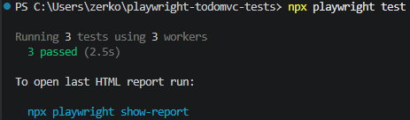

# Playwright TodoMVC Tests

Репозиторий с E2E-тестами на Playwright для публичного сервиса [TodoMVC Demo](https://demo.playwright.dev/todomvc/).

## Что тестируется:
1. Наличие ожидаемых текстов и элементов на странице (заголовки, плейсхолдеры).
2. Работа с интерактивными элементами и формами (добавление, выполнение и удаление задач).
3. Смена состояния страницы (переход по фильтрам и проверка URL).

## Результат прохождения тестов



## Как запустить локально

1. Клонируйте репозиторий:
   ```bash
   git clone https://github.com/DankaKein/playwright-todomvc-tests.git